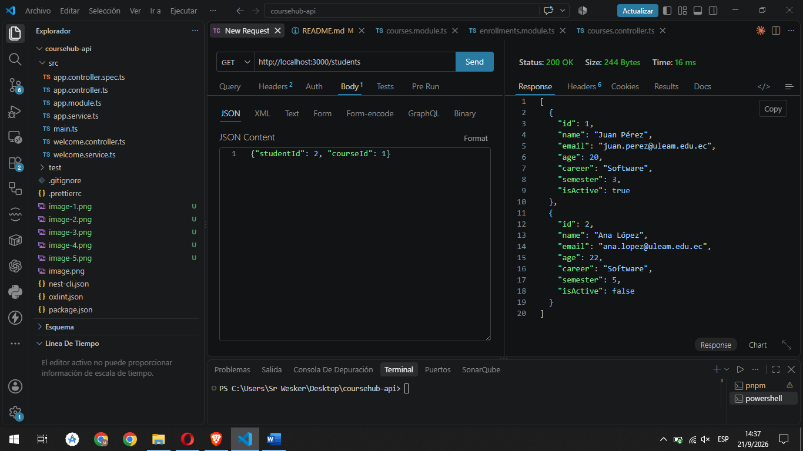
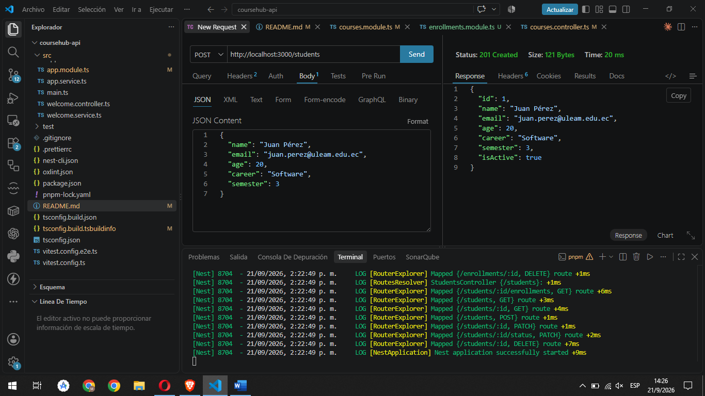
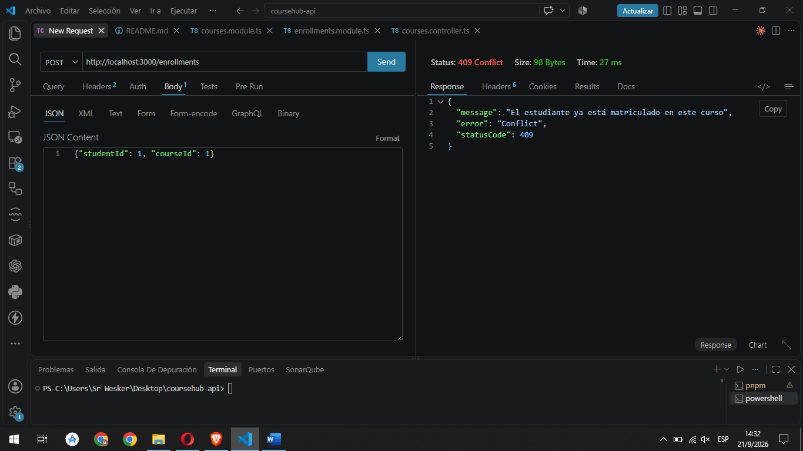
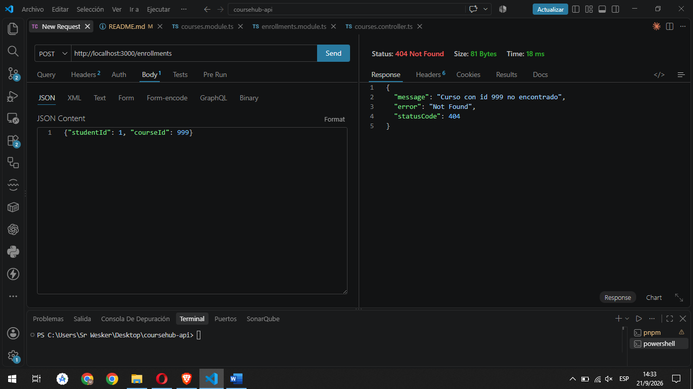
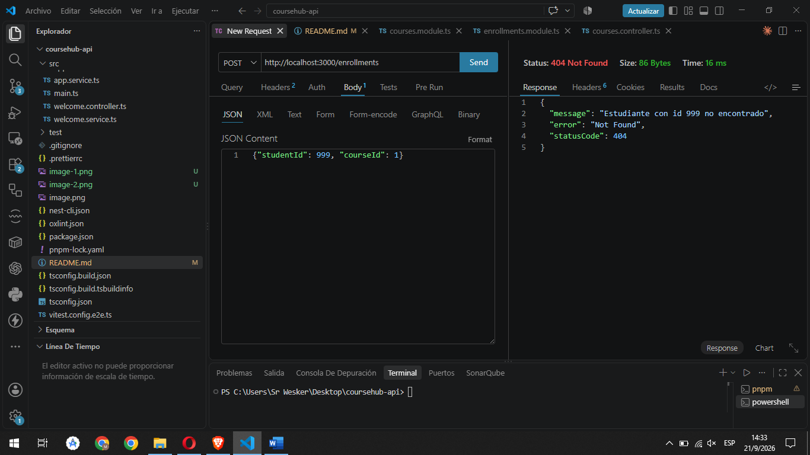
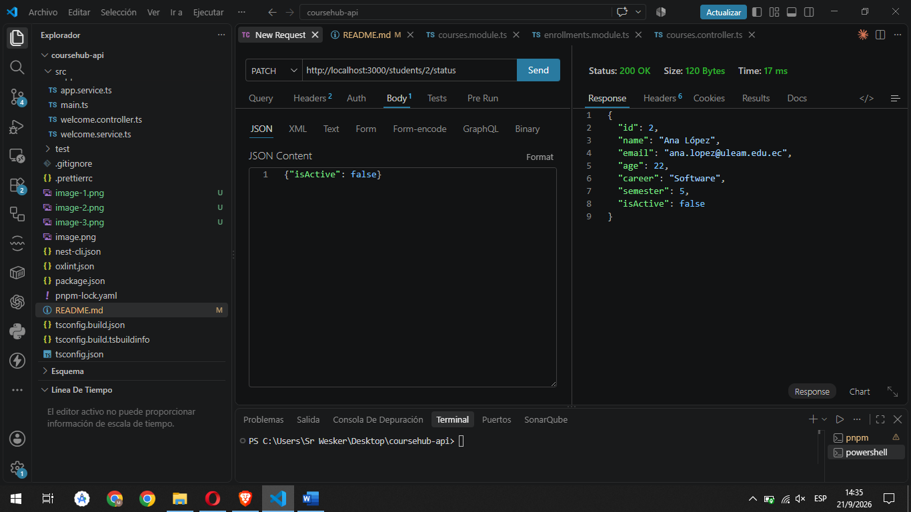
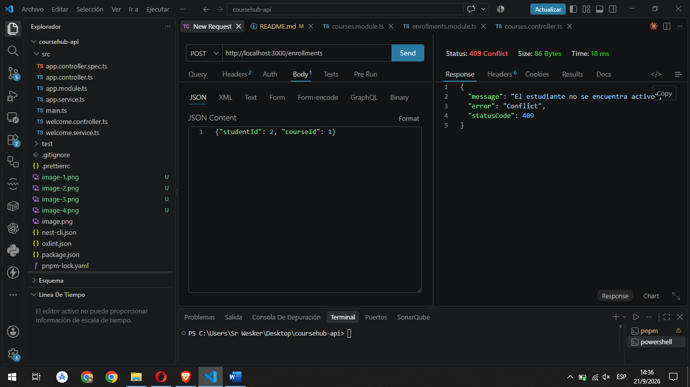
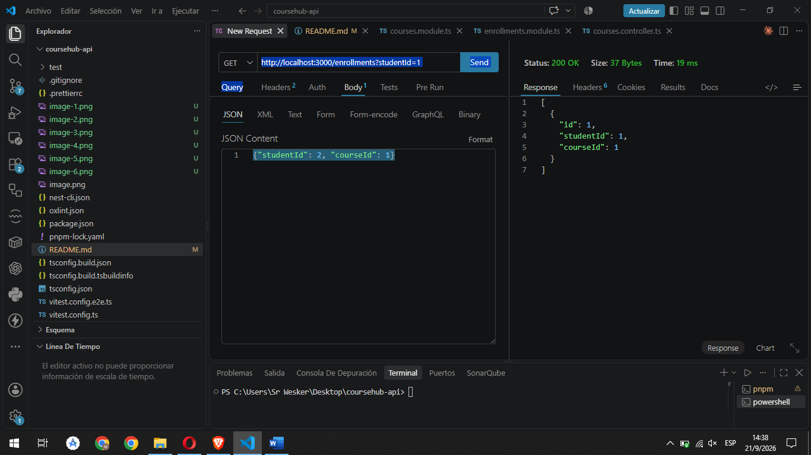
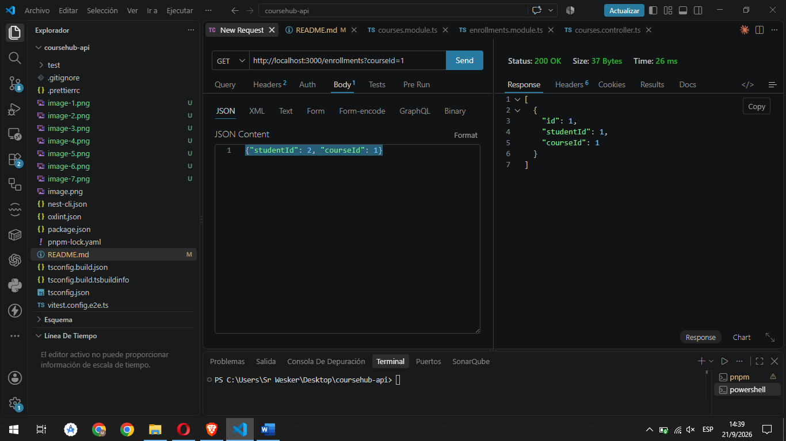

# CourseHub API

API REST desarrollada con NestJS para la gestión de **Cursos**, **Estudiantes** y **Matrículas**, utilizando almacenamiento en memoria (sin base de datos).

## Tecnologías

- NestJS
- TypeScript
- class-validator / class-transformer
- pnpm

## Instalación y ejecución

\`\`\`bash
pnpm install
pnpm run start:dev
\`\`\`

El servidor se levanta en `http://localhost:3000`.

---

## Módulo: Courses

| Método | Ruta               | Descripción                          |
|--------|--------------------|---------------------------------------|
| GET    | `/courses`         | Lista todos los cursos (filtro opcional `?level=`) |
| GET    | `/courses/:id`     | Consulta un curso por id             |
| POST   | `/courses`         | Crea un nuevo curso                  |
| PATCH  | `/courses/:id`     | Modifica parcialmente un curso       |
| DELETE | `/courses/:id`     | Elimina un curso                     |
| GET    | `/courses/:id/enrollments` | Lista las matrículas de un curso |

**Ejemplo — Crear curso**

Request:
\`\`\`json
POST /courses
{
  "title": "Testing NestJS",
  "level": "intermediate"
}
\`\`\`

Response `201 Created`:
\`\`\`json
{
  "id": 4,
  "title": "Testing NestJS",
  "level": "intermediate"
}
\`\`\`

---

## Módulo: Students

| Método | Ruta                     | Descripción                                  |
|--------|--------------------------|-----------------------------------------------|
| GET    | `/students`              | Lista estudiantes (filtros opcionales combinables: `career`, `semester`, `isActive`) |
| GET    | `/students/:id`          | Consulta un estudiante por id                |
| POST   | `/students`              | Registra un nuevo estudiante                 |
| PATCH  | `/students/:id`          | Modifica parcialmente un estudiante          |
| PATCH  | `/students/:id/status`   | Cambia exclusivamente el estado `isActive`   |
| DELETE | `/students/:id`          | Elimina un estudiante (solo si está activo)  |
| GET    | `/students/:id/enrollments` | Lista las matrículas de un estudiante     |

**Reglas de negocio**
- El `email` debe ser único.
- `semester` debe estar entre 1 y 10.
- No se puede eliminar un estudiante inactivo.

**Ejemplo — Crear estudiante**

Request:
\`\`\`json
POST /students
{
  "name": "Juan Pérez",
  "email": "juan.perez@uleam.edu.ec",
  "age": 20,
  "career": "Software",
  "semester": 3
}
\`\`\`

Response `201 Created`:
\`\`\`json
{
  "id": 1,
  "name": "Juan Pérez",
  "email": "juan.perez@uleam.edu.ec",
  "age": 20,
  "career": "Software",
  "semester": 3,
  "isActive": true
}
\`\`\`

**Ejemplo — Email duplicado**

Response `409 Conflict`:
\`\`\`json
{
  "message": "Ya existe un estudiante con ese correo",
  "error": "Conflict",
  "statusCode": 409
}
\`\`\`

**Ejemplo — Cambiar estado activo/inactivo**

Request:
\`\`\`json
PATCH /students/1/status
{
  "isActive": false
}
\`\`\`

**Ejemplo — Eliminar estudiante inactivo (bloqueado)**

Response `409 Conflict`:
\`\`\`json
{
  "message": "No se puede eliminar un estudiante inactivo",
  "error": "Conflict",
  "statusCode": 409
}
\`\`\`

---

## Módulo: Enrollments (Matrículas)

| Método | Ruta                | Descripción                                              |
|--------|---------------------|------------------------------------------------------------|
| GET    | `/enrollments`      | Lista matrículas (filtros opcionales combinables: `studentId`, `courseId`) |
| POST   | `/enrollments`      | Registra una nueva matrícula                              |
| DELETE | `/enrollments/:id`  | Cancela una matrícula                                     |

**Reglas de negocio**
- El estudiante y el curso deben existir.
- El estudiante debe estar activo.
- No puede existir una matrícula duplicada (mismo `studentId` + `courseId`).

**Ejemplo — Matrícula válida**

Request:
\`\`\`json
POST /enrollments
{
  "studentId": 1,
  "courseId": 1
}
\`\`\`

Response `201 Created`:
\`\`\`json
{
  "id": 1,
  "studentId": 1,
  "courseId": 1
}
\`\`\`

**Ejemplo — Matrícula duplicada**

Response `409 Conflict`:
\`\`\`json
{
  "message": "El estudiante ya está matriculado en este curso",
  "error": "Conflict",
  "statusCode": 409
}
\`\`\`

**Ejemplo — Estudiante inactivo**

Response `409 Conflict`:
\`\`\`json
{
  "message": "El estudiante no se encuentra activo",
  "error": "Conflict",
  "statusCode": 409
}
\`\`\`

**Ejemplo — Curso o estudiante inexistente**

Response `404 Not Found`:
\`\`\`json
{
  "message": "Curso con id 999 no encontrado",
  "error": "Not Found",
  "statusCode": 404
}
\`\`\`

**Ejemplo — Filtrar matrículas**

\`\`\`
GET /enrollments?studentId=1
GET /enrollments?courseId=1
\`\`\`

**Ejemplo — Cancelar matrícula**

\`\`\`
DELETE /enrollments/1
\`\`\`

Response `200 OK`:
\`\`\`json
{
  "id": 1,
  "studentId": 1,
  "courseId": 1
}
\`\`\`

**Ejemplo — Cancelar matrícula inexistente**

Response `404 Not Found`:
\`\`\`json
{
  "message": "Matrícula con id 999 no encontrada",
  "error": "Not Found",
  "statusCode": 404
}
\`\`\`

---

## Arquitectura

El proyecto sigue una organización modular por recurso, cada uno con su propia carpeta:

\`\`\`
src/
├── courses/
│   ├── dto/
│   ├── courses.controller.ts
│   ├── courses.service.ts
│   └── courses.module.ts
├── students/
│   ├── dto/
│   ├── pipes/
│   │   └── parse-int.pipe.ts
│   ├── students.controller.ts
│   ├── students.service.ts
│   └── students.module.ts
├── enrollments/
│   ├── dto/
│   ├── enrollments.controller.ts
│   ├── enrollments.service.ts
│   └── enrollments.module.ts
├── app.module.ts
└── main.ts
\`\`\`

Los controllers no contienen lógica de negocio: únicamente reciben la petición, delegan al service correspondiente y devuelven la respuesta. Las validaciones de entrada se realizan mediante DTOs con `class-validator`, y el `ValidationPipe` global (`whitelist: true, forbidNonWhitelisted: true`) rechaza cualquier dato no declarado en el DTO.

Se implementó un Pipe personalizado (`ParseIntPipe`) para transformar y validar los parámetros de ruta numéricos (`id`), reutilizado en los módulos `students` y `enrollments`.

Las dependencias circulares entre `EnrollmentsModule` y los módulos `CoursesModule`/`StudentsModule` (necesarias para las rutas anidadas de consulta) se resolvieron mediante `forwardRef()`.


Pruebas

estudiantes agregados 


matricula duplicada 

curso inexistente 

estudiante inexistente 


Desactivar etsudiante 2 


intentar matricular estudiante inactiva 


Filtrar matricula de los estudiantes 


Filtrar atricula por cursos 



CourseHub API — Evidencia de Demostración
Proyecto Semana 5: Persistencia de estudiantes y matrículas con PostgreSQL

====================================================================
PASO 1 — Crear un curso y un estudiante activo
====================================================================

POST /courses
Request:
{
  "title": "Programación Web Avanzada",
  "level": "advanced"
}
Response 201 Created:
{
  "id": 4,
  "title": "Programación Web Avanzada",
  "level": "advanced"
}

POST /students
Request:
{
  "name": "María Fernanda Zambrano",
  "email": "maria.zambrano@uleam.edu.ec",
  "age": 23,
  "career": "Software",
  "semester": 6
}
Response 201 Created:
{
  "id": 1,
  "name": "María Fernanda Zambrano",
  "email": "maria.zambrano@uleam.edu.ec",
  "age": 23,
  "career": "Software",
  "semester": 6,
  "isActive": true
}

====================================================================
PASO 2 — Crear una matrícula válida
====================================================================

POST /enrollments
Request:
{
  "studentId": 1,
  "courseId": 2
}
Response 201 Created:
{
  "id": 1,
  "student": {
    "id": 1,
    "name": "María Fernanda Zambrano",
    "email": "maria.zambrano@uleam.edu.ec",
    "age": 23,
    "career": "Software",
    "semester": 6,
    "isActive": true
  },
  "course": {
    "id": 2,
    "title": "Curso persistente de prueba",
    "level": "beginner"
  }
}

====================================================================
PASO 3 — Reiniciar la API y consultar la misma matrícula
====================================================================

[Servidor detenido con Ctrl+C y reiniciado con pnpm run start:dev]

GET /enrollments?studentId=1
Response 200 OK:
[
  {
    "id": 1,
    "student": { "id": 1, "name": "María Fernanda Zambrano", ... },
    "course": { "id": 2, "title": "Curso persistente de prueba", ... }
  }
]

La matrícula permanece disponible tras el reinicio, confirmando que ya no
depende de un arreglo en memoria sino de PostgreSQL.

====================================================================
PASO 4 — Matrícula duplicada (409)
====================================================================

POST /enrollments
Request:
{
  "studentId": 1,
  "courseId": 2
}
Response 409 Conflict:
{
  "message": "El estudiante ya está matriculado en este curso",
  "error": "Conflict",
  "statusCode": 409
}

====================================================================
PASO 5 — Estudiante inactivo
====================================================================

PATCH /students/1/status
Request:
{"isActive": false}
Response 200 OK:
{
  "id": 1,
  "name": "María Fernanda Zambrano",
  "isActive": false
}

POST /enrollments
Request:
{
  "studentId": 1,
  "courseId": 4
}
Response 409 Conflict:
{
  "message": "El estudiante no se encuentra activo",
  "error": "Conflict",
  "statusCode": 409
}

[Estudiante reactivado nuevamente con PATCH /students/1/status {"isActive": true}]

====================================================================
PASO 6 — Filtrar matrículas por estudiante o curso
====================================================================

GET /enrollments?studentId=1
Response 200 OK:
[
  {
    "id": 1,
    "student": { "id": 1, "name": "María Fernanda Zambrano", ... },
    "course": { "id": 2, "title": "Curso persistente de prueba", ... }
  }
]

GET /enrollments?courseId=2
Response 200 OK:
[
  {
    "id": 1,
    "student": { "id": 1, "name": "María Fernanda Zambrano", ... },
    "course": { "id": 2, "title": "Curso persistente de prueba", ... }
  }
]

====================================================================
PASO 7 — Cancelar la matrícula y comprobar que ya no se encuentra
====================================================================

DELETE /enrollments/1
Response 200 OK:
{
  "id": 1,
  "student": { ... },
  "course": { ... }
}

GET /enrollments?studentId=1
Response 200 OK:
[]

La matrícula fue cancelada correctamente y ya no aparece en las consultas.

====================================================================
Verificación adicional en base de datos (DBeaver)
====================================================================

- Tablas confirmadas en PostgreSQL: courses, students, enrollments
- Foreign keys confirmadas en la tabla enrollments:
  - FK hacia courses(id)
  - FK hacia students(id)
- Restricción de email único confirmada en la tabla students (@Column unique: true)
- Restricción única compuesta (student + course) confirmada en enrollments


## Listado de cursos: filtros, paginación y ordenamiento (semana 6 sesion 11 courseapi)

`GET /courses` acepta parámetros opcionales:

| Parámetro | Descripción | Valores / límites | Por defecto |
|-----------|-------------|-------------------|-------------|
| `level` | Filtra por nivel | `beginner`, `intermediate`, `advanced` | sin filtro |
| `title` | Filtra por título exacto | texto | sin filtro |
| `page` | Número de página | entero ≥ 1 | 1 |
| `limit` | Resultados por página | entero entre 1 y 50 | 10 |
| `sortBy` | Campo de orden | `id`, `title`, `level` | `id` |
| `order` | Dirección | `ASC`, `DESC` | `ASC` |

Petición válida:

```
GET /courses?level=beginner&page=2&limit=3&sortBy=title&order=ASC
```

Respuesta resumida (`200 OK`):

```json
{
  "items": [
    { "id": 3, "title": "Git y GitHub desde cero", "level": "beginner" }
  ],
  "meta": { "total": 4, "page": 2, "limit": 3, "totalPages": 2 }
}
```

Petición inválida (`400 Bad Request`):

```
GET /courses?sortBy=createdAt
```

`sortBy` se compara con una lista cerrada de campos; nunca se usa directamente el valor recibido, para evitar consultas inseguras. `total` es la cantidad de cursos que cumplen el filtro; `items.length` es solo lo que trae la página actual.


## Búsqueda de matrículas con QueryBuilder (semana 6 sesion 12 courseapi)

`GET /enrollments` combina búsqueda de texto, filtros y paginación. Devuelve cada matrícula con su `student` y su `course`.

| Parámetro | Descripción | Valores / límites | Por defecto |
|-----------|-------------|-------------------|-------------|
| `search` | Texto contenido en el nombre del estudiante o en el título del curso (sin distinguir mayúsculas) | texto | sin búsqueda |
| `studentId` | Filtra por estudiante | entero ≥ 1 | sin filtro |
| `courseId` | Filtra por curso | entero ≥ 1 | sin filtro |
| `activeOnly` | Solo matrículas de estudiantes activos | `true` / `false` | sin filtro |
| `page` | Número de página | entero ≥ 1 | 1 |
| `limit` | Resultados por página | entero entre 1 y 50 | 10 |

Petición:

```
GET /enrollments?search=nest&activeOnly=true&page=1&limit=5
```

Respuesta resumida (`200 OK`):

```json
{
  "items": [
    {
      "id": 5,
      "student": { "id": 3, "name": "Ana Lopez", "isActive": true },
      "course": { "id": 6, "title": "Introduccion a NestJS", "level": "beginner" }
    }
  ],
  "meta": { "total": 2, "page": 1, "limit": 5, "totalPages": 1 }
}
```

Una búsqueda sin coincidencias responde `200` con `items: []` y `total: 0`, porque la colección existe aunque ninguna fila coincida.

El texto de búsqueda se envía como parámetro (`:search`) y nunca se concatena en la consulta, por lo que entradas como `' OR 1=1 --` se tratan como texto y no alteran la consulta SQL.


## Configuración por variables de entorno (semana 7 sesion 13)

La aplicación lee su configuración desde un archivo `.env` y la valida al iniciar. Si falta una variable obligatoria o tiene un valor inválido, el arranque se detiene y el mensaje nombra la variable.

1. Copia la plantilla: `.env.example` → `.env`.
2. Reemplaza `DB_PASSWORD` por tu contraseña local de PostgreSQL.

| Variable | Descripción | Obligatoria | Por defecto |
|----------|-------------|-------------|-------------|
| `NODE_ENV` | Ambiente: `development`, `test` o `production` | No | `development` |
| `PORT` | Puerto de la API | No | `3000` |
| `DB_HOST` | Servidor de PostgreSQL | Sí | — |
| `DB_PORT` | Puerto de PostgreSQL | No | `5432` |
| `DB_NAME` | Nombre de la base de datos | Sí | — |
| `DB_USER` | Usuario de PostgreSQL | Sí | — |
| `DB_PASSWORD` | Contraseña del usuario | Sí | — |

Ejemplo de falla con `DB_PORT=not-a-number`:

```
Config validation error: "DB_PORT" must be a number
```

El archivo `.env` contiene credenciales y nunca se sube al repositorio (está en `.gitignore`). Solo se publica `.env.example`, que tiene nombres y valores ficticios.

El modo `start:dev` no recarga al cambiar el `.env`: detén y vuelve a iniciar el servidor.